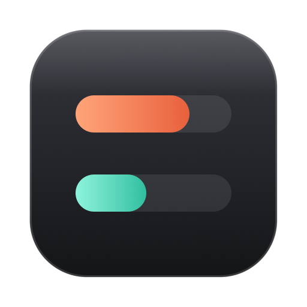

<p align="center">
  
</p>

<h1 align="center">TokenBar</h1>

<p align="center">
  <b>Your Claude and Codex usage limits, one click away in the Mac menu bar.</b>
</p>

<p align="center">
  <a href="https://github.com/jhrahman/TokenBar/releases/download/v0.1.0/TokenBar-0.1.0.dmg">
    
  </a>
</p>

<p align="center">
  
  
  
</p>

<p align="center">
  
  
  
  
  
  <a href="LICENSE"></a>
</p>

---

TokenBar is a small app that lives in your Mac's menu bar and shows how much of your Claude and Codex usage limits you have left, so you stop finding out the hard way that you hit the cap mid-task.

Click the icon and you get a tiny popover with your 5 hour usage, your weekly usage, and exactly when each one resets. There is also an optional cost view that shows roughly how many dollars your usage would be worth at API prices.

It has no Dock icon, no account to create, no database and no analytics. It just sits in the menu bar and stays out of your way.

## What it shows

**Usage and resets**

- Your 5 hour usage as a percentage, with a live countdown like "resetting in 1.3h"
- Your weekly usage as a percentage, with the exact reset time like "resetting Wed, 11 Nov, 6 PM"
- Times always use your Mac's current time zone, so they follow you when you travel
- The menu bar icon is drawn from what you have switched on: two bars if you watch both Claude and Codex, one bar if you watch just one

**Cost view (Claude)**

Click "This cycle on this Mac" in the popover to open a details window. It shows:

- Estimated dollars for the current 5 hour window, the current week, and your current billing cycle
- A chart with bars stacked by model, so you can see what your Opus and Sonnet usage each cost
- A hover readout for any day or hour, and a running total view
- How far you are through your billing cycle

You tell TokenBar which day of the month your plan renews, and the monthly total starts over on that day.

## Things worth knowing before you install

TokenBar is honest about what it can and cannot see.

- **Dollar amounts are estimates.** Anthropic does not publish dollar figures for subscription plans. TokenBar counts the tokens in Claude Code's local log files and prices them at Anthropic's public API rates. Think of it as "what this usage would be worth", not "what you were charged".
- **Dollar amounts only cover this Mac.** If you also use Claude on another computer, on the web, or in the Claude app, that usage is not in the dollar figures. The percentage bars are different. They come from Anthropic's servers for your whole account, so they stay accurate across every device.
- **It uses unofficial endpoints.** Neither Anthropic nor OpenAI offers a public API for reading subscription limits. TokenBar uses the same private endpoints the official tools use, and those can change or break without notice. If that happens, the popover will tell you something went wrong.
- **Codex support is untested.** It is built from how the Codex login and usage service are known to work, but it has not been checked against a real Codex account yet. If you use Codex, please try it and report what you see.
- **Browser sign-in is not available yet.** For now TokenBar reads the login that the official Claude Code or Codex tool already saved on your Mac. That means you need to have one of them installed and signed in. A browser sign-in option is planned for when there is an approved way to do it.
- **It is not affiliated with Anthropic or OpenAI.** The Claude and Codex marks in the popover are simple shapes drawn for this app, not the official artwork.

## Requirements

- A Mac running macOS 13 (Ventura) or newer, Apple Silicon or Intel
- Claude Code installed and signed in, and/or Codex installed and signed in
- Xcode Command Line Tools, only if you build it yourself (see below)

## Install

There are two ways to get TokenBar. Downloading a release is the easy one. Building it yourself takes a couple of minutes and you only do it once.

### Option A: Download a release

1. Click the **Download** badge at the top of this page to get `TokenBar-0.1.0.dmg` (or find it on the [latest release](https://github.com/jhrahman/TokenBar/releases/latest))
2. Double click the disk image and drag TokenBar onto the Applications shortcut
3. Jump to "Open it for the first time" below

### Option B: Build it yourself

#### 1. Get the Command Line Tools

Open Terminal and run:

```
xcode-select --install
```

If they are already installed, it will tell you so and you can move on.

#### 2. Build the app

Download or clone this repository, then in Terminal go into the folder and run:

```
cd TokenBar
./build.sh
```

When it finishes you will have these in the `build` folder:

- `TokenBar-0.1.0.dmg`, a disk image for installing
- `TokenBar.app`, the app itself
- `TokenBar-0.1.0.zip`, handy for sharing with your own devices

It is a universal app, so the same build runs on both Apple Silicon and Intel Macs.

#### 3. Install from the disk image

Double click `build/TokenBar-0.1.0.dmg`. A window opens showing TokenBar and an Applications shortcut. Drag TokenBar onto Applications, then eject the disk image. Keeping the app in Applications also lets the "Launch at login" option work properly.

If you prefer, you can skip the disk image and drag `build/TokenBar.app` into Applications yourself.

### Open it for the first time

Because the app is not notarized by Apple, macOS may warn you the first time. If it refuses to open:

1. Right click (or Control click) TokenBar in Applications and choose **Open**
2. Choose **Open** again in the dialog

You only need to do this once. If you still see a block, go to System Settings, then Privacy & Security, scroll down, and click **Open Anyway** next to the TokenBar message.

### Allow it to read your Claude login

The first time TokenBar needs your Claude login, it shows its own short explanation and then macOS asks for your Mac password. This is normal. Claude Code keeps its login in your Keychain, and macOS asks before any app can read it.

- Nothing is taken away or changed. TokenBar only reads the login. It never edits or deletes it.
- Your password goes to macOS. TokenBar never sees or stores it.
- The login is used only to ask Anthropic for your usage numbers. It is kept in memory, and it is not saved or sent anywhere else.

Choose **Always Allow** so you are not asked again. Note that macOS treats each newly built copy of the app as a new app, so if you rebuild it yourself you will be asked once more.

Once that is done, look for the two bars in your menu bar. Click them to see your usage.

## Settings

Open Settings from the popover. You can:

- Turn on **Launch at login**
- Choose to monitor Claude, Codex, both, or neither. Changes apply instantly and each change shows a small confirmation
- Set the day your Claude plan renews, which controls the billing cycle in the cost view
- Pick how often TokenBar refreshes: every 5, 15 or 30 minutes

The refresh options start at 5 minutes on purpose. The usage endpoints rate limit apps that ask too often.

## If something looks wrong

- **"Rate limited"**: the usage service asked TokenBar to slow down. It waits, shows your last known numbers in the meantime, and tries again by itself. Opening the popover repeatedly will not speed this up.
- **"Not logged in" or "Open Claude once"**: sign in again with Claude Code or Codex, then reopen TokenBar.
- **"Keychain access not allowed yet"**: you chose Not now or Deny. Open the popover again and choose Continue when asked.
- **Dollar amounts look low**: remember they only count usage on this Mac, and only Claude Code usage.

## Privacy

TokenBar talks to exactly two kinds of places: Anthropic's usage service for Claude, and OpenAI's usage service for Codex. It sends your existing login to them to ask for your numbers, the same way the official tools do. It has no analytics, no tracking and no servers of its own. Your settings are stored on your Mac in the standard app preferences.

For the dollar estimates it reads Claude Code's log files in `~/.claude/projects`. It only reads them. It never changes them and never uploads them.

## Uninstall

Quit TokenBar from its popover, then delete `TokenBar.app` from Applications. If you turned on Launch at login, switch it off in Settings first. To remove saved settings, run `defaults delete com.tokenbar.app` in Terminal.

## For developers

TokenBar is a Swift package with no dependencies, built with SwiftUI and Swift Charts.

```
Sources/TokenBarCore/   pure logic: parsing, reset text, pricing, cost math
Sources/TokenBar/       the app: menu bar, popover, settings, log scanner
Tests/                  unit tests and sample responses
VERSION                 the app version, read by build.sh
build.sh                builds the universal .app, a .zip and a .dmg
```

Run `swift build` for a quick debug build. The unit tests use XCTest, so running `swift test` needs a full Xcode install rather than just the Command Line Tools.

### Releasing a new version

1. Change the number in the `VERSION` file, for example to `0.2.0`
2. Run `./build.sh`. The version is stamped into the app and into the file names
3. Create a GitHub release tagged `v0.2.0` and upload `build/TokenBar-0.2.0.dmg` and `build/TokenBar-0.2.0.zip`
4. Update the version number in the Download badge link and the version badge at the top of this README

The version also shows at the bottom of the app's Settings window.

## License

TokenBar is released under the [MIT License](LICENSE).
